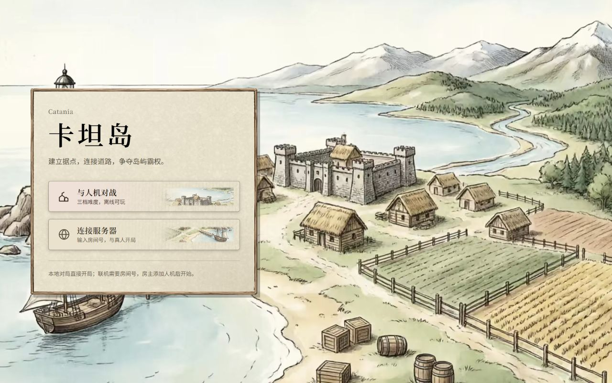
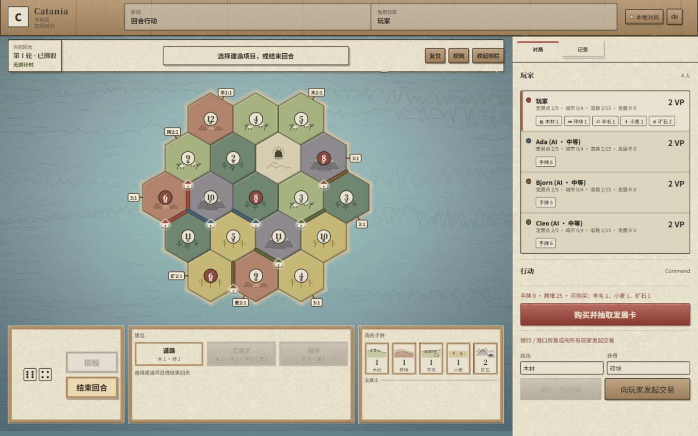
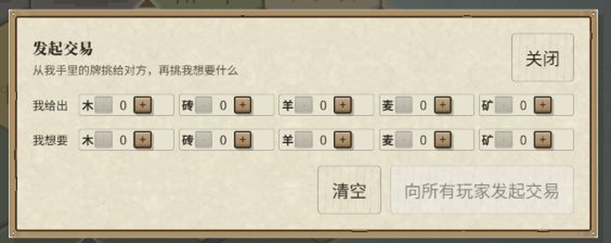

# Catania · 卡坦岛

从零手写的 Catan 风格网页游戏：规则引擎 + WebSocket 权威服务器 + 复古羊皮纸手绘界面。
前端零框架（原生 JS + SVG），后端只用 Node 内置能力加一个 `ws`。





## 有什么

**规则（标准 19 格盘）**

- 54 个交点 / 72 条边的共享图结构，9 个港口；地图生成额外保证同一交点不接壤三片相同资源
- 蛇形初始放置、定居点距离规则、初始道路必须连着刚放下的村子
- 掷骰生产（村子 1 份、城市 2 份），银行库存不足时整项资源不发放
- 点数 7：超 7 张的玩家先弃牌，再移强盗，单目标自动偷、多目标手选
- 建造道路 / 定居点 / 城市，含连接校验、棋子上限、升级城市
- 25 张发展卡（骑士、道路建设、丰收之年、垄断、胜利点），同回合不可用
- 最长道路、最大军队，按规则正确转移
- 银行 4:1 / 3:1、资源港 2:1；玩家交易按座位顺序逐一回应，全部回应后才能成交
- 10 分结束并记录终局战绩

**联机**

- WebSocket 权威服务器：客户端只发命令，规则与随机数都在服务端
- 房间号进房、真人座位、准备、房主添加 / 移除人机、2 真人 + 2 人机开局
- 命令幂等、版本冲突检测、断线重连（浏览器关掉也能回到原座位）
- 断线宽限后 AI 接管、房主迁移、房间清理
- 只读观战：不占座位、只收公开视图、可设观战上限
- 服务器权威回合计时，超时自动执行合法动作

**其它**

- SQLite 存房间、游戏快照、事件、命令结果与终局战绩，另带复盘查询、玩家统计、备份恢复三个小工具
- 简单 / 中等 / 困难三档启发式 AI，会评估放置点、按资源需求建造、挑强盗目标、发起并回应交易
- 每名玩家只收到自己的视图，对手手牌与私有事件不进客户端

## 界面

羊皮纸 + 木框的复古殖民风，所有尺寸都以棋盘的用户单位为准。



- 棋盘是手绘 SVG（不是贴图）：地形图案、暗红木牌数字、港口小旗、海岸沙滩过渡、
  六边形统一投影、近海浅水与远海深水的色差
- 棋盘 `viewBox` 只有 10 个单位宽，所以**一律不用 CSS 滤镜**：`drop-shadow` /
  `filter` 在这里会被算成错误的滤镜区域，实测会把整块棋盘炸成黑块；
  所有柔光、投影、内阴影都是叠形状做出来的
- 海面缓慢流动：海图放在一块比舞台大 8% 的浮层上，只动 `transform`，不重排也不重绘
- 音效全部 WebAudio 现场合成，仓库里一个音频文件都没有
- 皮肤是独立的 `debug/skin-parchment.css`，加载在 `style.css` 之后；
  删掉 `game.html` / `index.html` 里那一行 link 就回到最初那套深海配色

## 快速开始

需要 **Node 22.5+**（用到内置的 `node:sqlite`），开发时用的是 24.x。

```bash
npm install
npm run dev
```

打开 <http://127.0.0.1:4173/>，首页两个入口：

- **与人机对战**：选 AI 数量和难度，直接开局，离线可玩
- **连接服务器**：填房间号，和真人一起开局

`debug/bundle.js` 是 `npm run build:debug` 从 `debug/app.js` 打出来的无模块依赖文件，
所以也可以直接打开 `debug/index.html` 离线运行（没有服务器时只有本地对局能玩）。

## 怎么玩

1. **初始放置**：轮流放 2 个村子和 2 条路，第一轮正序、第二轮倒序。点棋盘上的高亮点，再点确认。
2. **掷骰**：轮到你时点「掷骰」，按点数给地块生产资源；掷出 7 走强盗流程。
3. **建造**：先点「道路 / 定居点 / 城市」，再点棋盘上高亮的位置，同样是点一下、确认牌、确认。
4. **交易**：和银行按港口比率换，或点「向玩家发起交易」在弹窗里挑牌报价；由其他玩家逐一回应，
   发起者最后决定成交还是取消。
5. **发展卡**：花资源抽一张，当回合不能用；骑士、道路建设、丰收之年、垄断各有各的用法。

快捷键：`R` 掷骰、`E` 结束回合、`Space` 确认、`1/2/3` 选建造类型、`Esc` 取消。

## 联机怎么跑

1. 两个浏览器标签页都打开 `/debug/`
2. 填同一个房间号，点「连接服务器」
3. 房主「创建房间」（或进已有房间），添加人机、调难度
4. 两个真人点准备，房主点开始

WebSocket 端点是 `ws://127.0.0.1:4173/ws`。回合倒计时默认 60 秒，可用环境变量改：

```powershell
$env:CATANIA_TURN_TIMER_MS="90000"; npm run dev
```

对局数据默认落在 `data/catania.sqlite`（这个目录不入库），可用 `CATANIA_DB_PATH` 换位置。

## 命令

```bash
npm run dev          # 起服务器：静态文件 + WebSocket + SQLite
npm run build:debug  # 把 debug/app.js 打包成 debug/bundle.js
npm test             # 97 项测试

npm run db:backup    # 备份数据库
npm run db:restore -- data/backups/xxx.sqlite
npm run replay -- <房间号> [对局号]   # 打印某个房间的事件流
npm run stats [玩家名]                 # 打印基础战绩
```

## 版本

- 项目版本在 `package.json` 的 `version`（当前 `0.9.0`），
  HTML 里的 `<meta name="catania-build">` 跟它保持一致
- HTML 引用静态资源时带的 `?v=` 是**缓存击穿**：改了 CSS 或 JS 就把那个数字加一，
  玩家不用硬刷新（皮肤和 bundle 各有一套号，互不影响）
- 改完 `debug/app.js` 要跑一次 `npm run build:debug`：游戏页加载的是 `bundle.js`
- 完整历史见 [CHANGELOG](CHANGELOG.md)

## 目录

```text
debug/                 实际跑的前端：index.html 首页、game.html 对局页
  app.js               全部界面与交互逻辑（打包入口）
  bundle.js            build:debug 的产物
  skin-parchment.css   羊皮纸皮肤层，可以整层摘掉
  sound.js             WebAudio 音效合成
  assets/              位图素材：地形 / 卡面插画 / 木框 / 羊皮纸 / 海图
src/core/              规则引擎：状态、命令、事件、投影、地图、会话
src/bots/              启发式 AI
src/network/           WebSocket 房间、协议、SQLite 仓库
scripts/               开发服务器与几个小工具
tests/                 Node 内置测试
docs/                  设计与路线文档、截图
```

## 测试

```bash
npm test
```

97 项，覆盖地图不变量、蛇形顺序、非法放置、道路连接、资源生产与守恒、银行短缺、
建造与棋子上限、城市升级、胜负判定、弃牌与强盗、偷取目标、隐藏信息、发展卡全部效果、
奖励转移、港口比率、玩家交易顺序、WebSocket 房间与权威命令、事件补发、断线接管、
重连恢复、SQLite 持久化恢复、观战权限、回合超时、房主控制、事件归档，
以及三档 AI 的合法性与交易限流。

## 已知边界

- 还没做正式账号和公网部署，现在是游客身份 + 本机 SQLite
- 排行榜、好友、匹配都没有
- 没有 3D 渲染，2D 是唯一渲染路径
- 小屏（手机）还没适配：窄屏下侧栏会盖住棋盘，这项在待办里

## 文档

- [完整功能与实现路线](docs/full-game-design-and-roadmap.md)
- [Command / Event 清单](docs/catan-command-event-catalog.md)
- [第一阶段实现说明](docs/phase-1-implementation.md)
- [第二阶段设计](docs/phase-2-design.md)
- [开源项目借鉴映射](docs/phase-1-borrowing-map.md)
